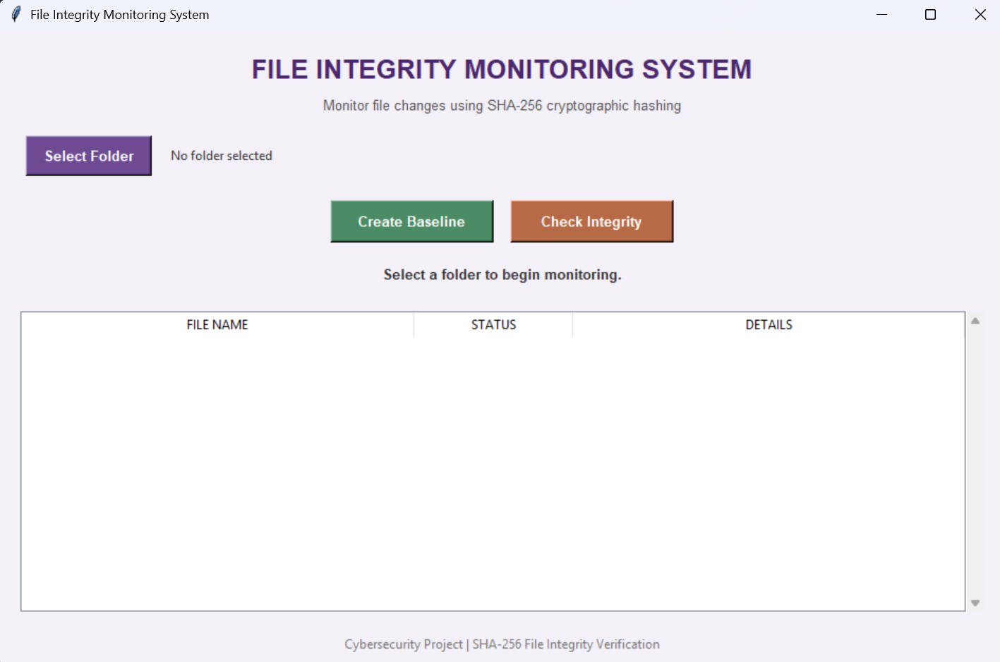
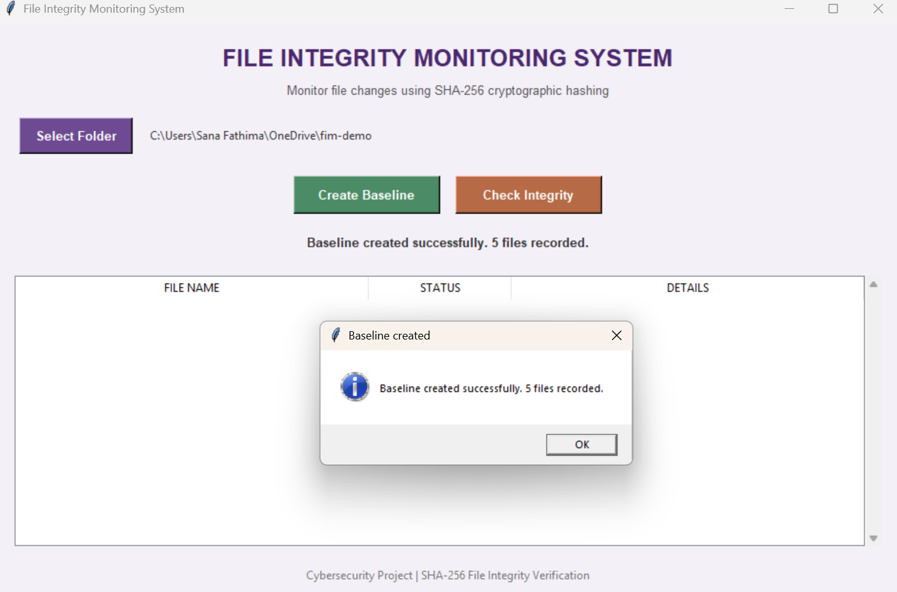
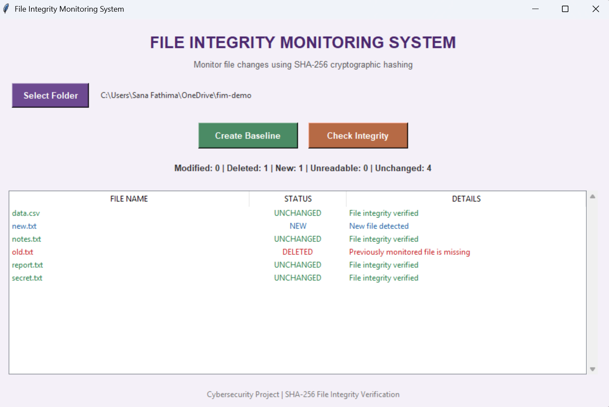
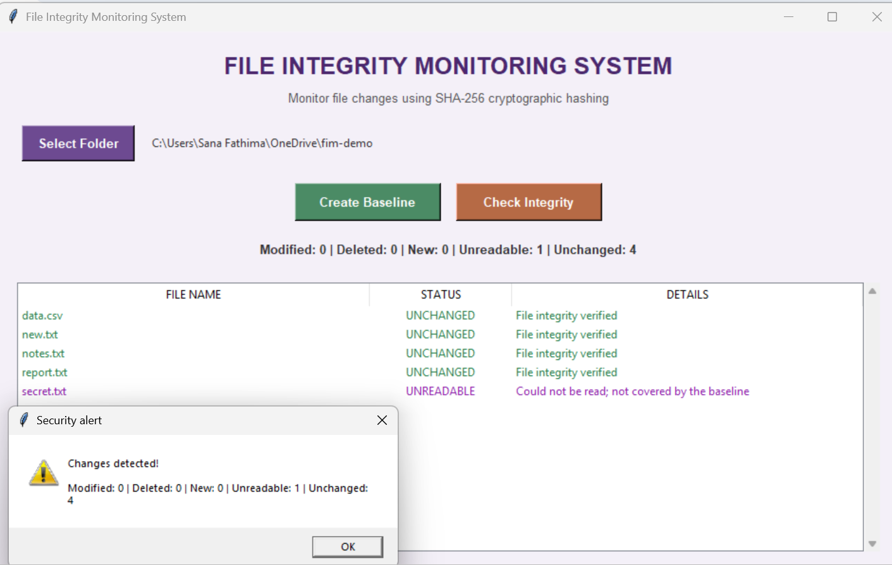

# File Integrity Monitoring System (FIM)

A Python desktop application that detects changes to files in a chosen folder by comparing their SHA-256 hashes against a previously saved baseline.

> **Important:** This tool performs **on-demand integrity verification**. It checks a folder when you click **Check Integrity**; it does not watch files in real time. It detects that files **changed**, but it **cannot determine whether a change was authorized**.

## Overview

File integrity monitoring is a standard security control: record a trusted "known good" state of important files, then later check whether anything differs. Unexpected changes can indicate tampering, malware, or accidental modification.

This project is an educational implementation of that idea:

1. **Create a baseline:** The app hashes every readable file in a folder with SHA-256 and saves the results as JSON.
2. **Check integrity:** The app hashes the folder again and compares the result with the baseline.
3. Each file is reported as `MODIFIED`, `DELETED`, `NEW`, `UNCHANGED` or `UNREADABLE`.

## Features

- Folder selection through a Tkinter GUI
- SHA-256 hashing of file contents, read in chunks so large files do not need to fit in memory
- Recursive scanning of sub-folders
- Baseline stored as a JSON file (one baseline per monitored folder)
- Detection of modified, deleted, new and unchanged files
- Separate `UNREADABLE` status for files and folders that cannot be accessed, so they are never wrongly reported as deleted or new
- Colour-coded results table and a summary count for every status
- Confirmation prompt before an existing baseline is replaced
- Baseline is written atomically (temporary file + `os.replace()`), so an interrupted write cannot corrupt an existing baseline
- Baseline structure is validated before use; a malformed baseline produces an error message, not a crash
- Symbolic links and non-regular files are skipped
- The `fim_baselines` folder is excluded from scans

## Technologies Used

- Python 3.8 or newer
- Standard library only: `hashlib`, `json`, `os`, `pathlib`, `re`, `datetime`, `tkinter`, `unittest`
- No third-party packages

## Installation and Running

Clone the repository:

```bash
git clone https://github.com/Sara-png-ops/file-integrity-monitor.git
```

Navigate into the project folder:

```bash
cd file-integrity-monitor
```

Run the application:

```bash
python main.py
```

Use `python3` instead of `python` if that is how Python is installed on your system.

Tkinter ships with the standard Python installers for Windows and macOS. On Debian/Ubuntu Linux it may need installing separately:

```bash
sudo apt install python3-tk
```

There is no `requirements.txt` because the project has no external dependencies.

## How the Baseline Comparison Works

1. **Scan.** The app walks the selected folder. For each regular file it computes the SHA-256 hash of the file's contents and records it against the file's path relative to the selected folder. Files or folders that cannot be read are recorded in a separate unreadable list.
2. **Baseline.** The relative paths and hashes are saved to `fim_baselines/<id>.json`, together with the folder path, a creation time, and the unreadable list. `<id>` is a SHA-256 hash of the folder's full path, so each folder has its own baseline.
3. **Check.** The app loads and validates the baseline, scans the folder again, and compares the two snapshots:

| Status | Meaning |
|---|---|
| `UNCHANGED` | In the baseline and now, with the same hash |
| `MODIFIED` | In the baseline and now, but the hash is different |
| `DELETED` | In the baseline, but no longer present in the folder |
| `NEW` | Present now, but not in the baseline |
| `UNREADABLE` | Could not be read now, so its integrity cannot be verified |

A file that cannot be read is always reported as `UNREADABLE`, never as `DELETED` or `NEW`, because its real state is unknown. A hash is a fingerprint of the file's content: if even one byte changes, the SHA-256 value is completely different.

## How to Use

1. Create a **separate test folder** with a few sample files.
2. Run `python main.py` and click **Select Folder**.
3. Click **Create Baseline** to record the current hashes.
4. In the test folder, edit a file, delete a file and add a new file.
5. Click **Check Integrity**. The table lists every file with its status, and the summary line shows the count for each status.

The screenshots demonstrate the application using a test folder containing sample files created for demonstration purposes.

## Known Limitations

- **On-demand only.** There is no real-time monitoring, scheduling or alerting outside the application window.
- **Detects changes, not intent.** The tool cannot tell whether a change was authorized, legitimate or malicious.
- **The baseline is not protected.** It is a plain JSON file. Anyone who can modify the monitored files and the `fim_baselines` folder can also modify the baseline. A production tool would sign or store the baseline separately.
- **A baseline records the folder as it is at that moment.** If the folder is already compromised when the baseline is created, the compromised state is treated as trusted.
- **Content only.** File permissions, ownership and timestamps are not recorded, so a change to those alone is not detected.
- **Symbolic links are skipped**, so replacing a file with a link is not detected.
- **Unreadable files cannot be verified.** They are reported, but nothing is known about their content.
- **Files that change while a scan is running** may produce inconsistent results.
- **Large folders:** Scanning runs on the GUI thread, so the window may stop responding until the scan finishes.
- **Not a replacement for production tools** such as AIDE, Tripwire or OSSEC/Wazuh.

## Testing

The core logic is covered by automated tests that use only the standard library:

```bash
python -m unittest -v
```

The tests cover SHA-256 hashing, baseline creation and loading, detection of modified, deleted, new and unchanged files, unreadable files and folders, exclusion of the baseline folder, atomic baseline writing, and rejection of invalid baselines. They create temporary folders and do not touch your own files.

## Screenshots

### 1. Main Application Window



*The application's main interface.*

### 2. Baseline Created



*The initial file baseline has been successfully created.*

### 3. Integrity Check Results



*Modified, deleted and new files detected after changes to the test folder.*

### 4. Unreadable File Detection



*A file that could not be read is reported as UNREADABLE, not as deleted.*

## Project Structure

```text
file-integrity-monitor/
├── main.py
├── test_fim.py
├── README.md
├── .gitignore
├── screenshots/
│   ├── 01-main-window.png
│   ├── 02-baseline-created.png
│   ├── 03-results-changes.png
│   └── 04-results-unreadable.png
└── fim_baselines/   # Created automatically; ignored by Git
```

## Possible Future Improvements

- Protect the baseline (for example with a keyed HMAC)
- Record file permissions and sizes
- Run scans in a background thread with a progress indicator
- Export results to CSV
